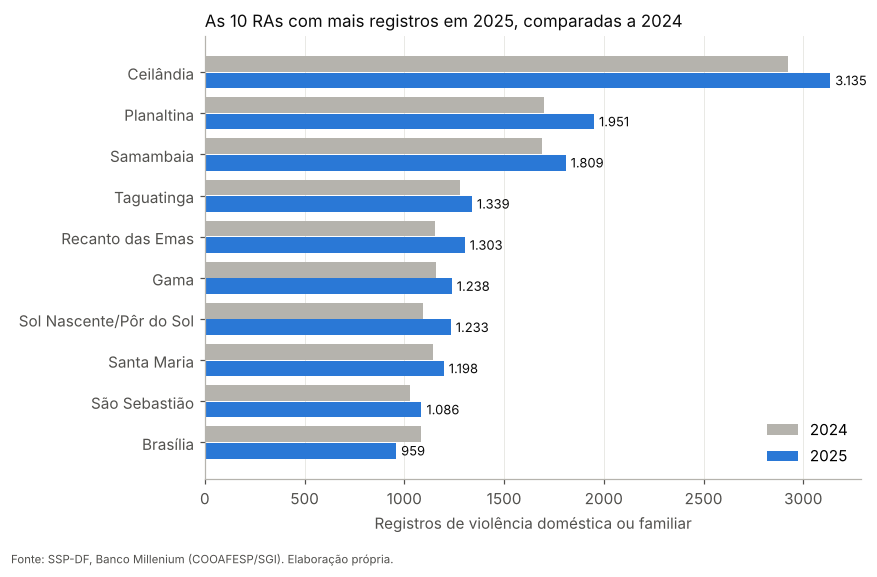
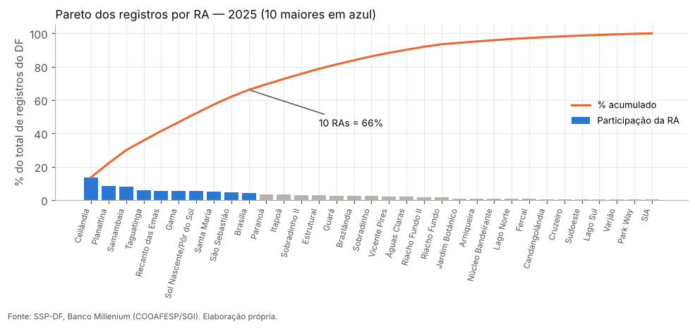
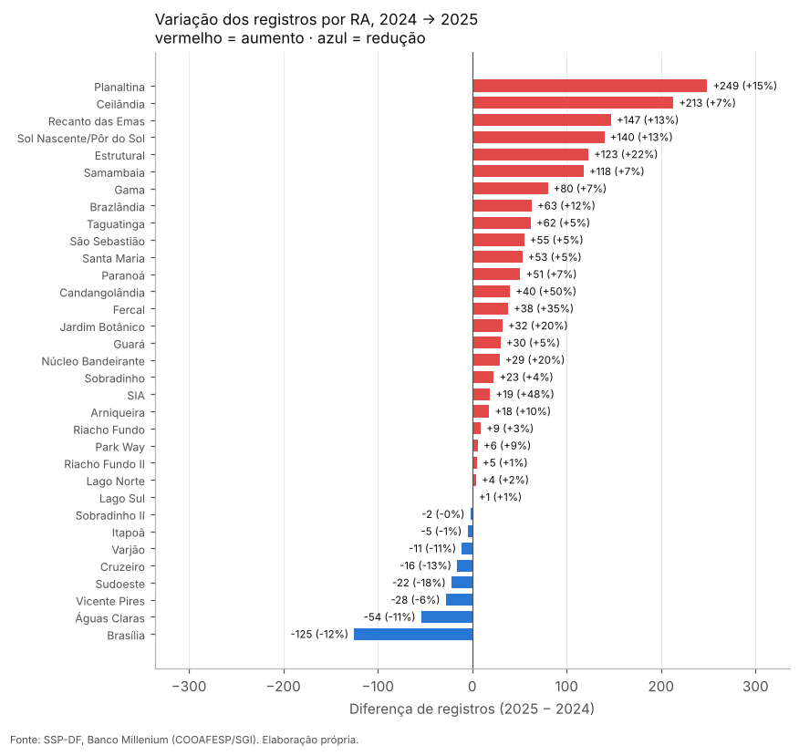
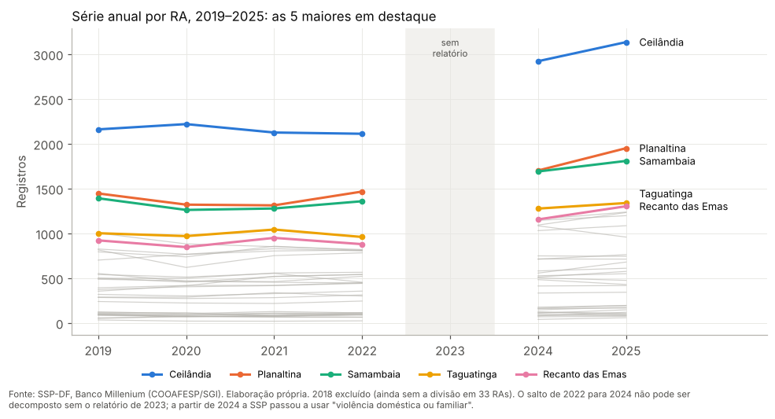
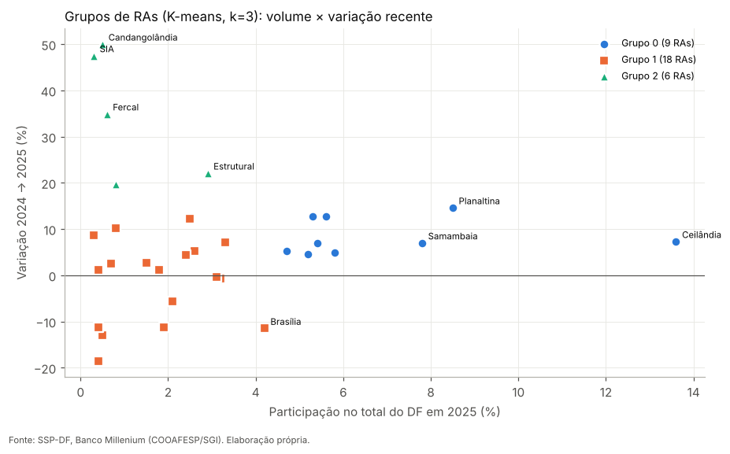

# Fase 4 — Modelagem (CRISP-DM)

**Pergunta de negócio:** Quais regiões administrativas do Distrito Federal apresentam os maiores registros de violência doméstica de 2024 a 2025?  
**Notebook:** [`notebooks/02_modelagem.ipynb`](notebooks/02_modelagem.ipynb) · **Base:** `dados/processados/violencia_domestica_ra.csv` · **Semente:** 42

## 4.1 Seleção das técnicas

A pergunta é **descritiva**: quer saber *onde* os registros se concentram e *como* mudaram, e não prever casos futuros. Por isso não foi treinado um modelo preditivo. As técnicas escolhidas foram:

| Técnica | Pergunta que responde | Ferramenta |
|---|---|---|
| Ranking e participação percentual | Quais RAs têm mais registros? | pandas |
| Análise de Pareto | Quantas RAs concentram a maior parte dos casos? | pandas, matplotlib |
| Variação absoluta e percentual | Onde houve aumento ou queda de 2024 para 2025? | pandas |
| Correlação de postos de Spearman | O ranking é estável entre os anos? | scipy |
| Agrupamento K-means (não supervisionado) | Quais RAs têm perfil parecido de volume e variação? | scikit-learn |

## 4.2 Design de teste

- **Ranking:** calculado de três formas (só 2025, só 2024 e soma 2024+2025) para conferir se a resposta depende do recorte.
- **Spearman:** aplicado aos anos com 33 RAs (2019–2022, 2024, 2025).
- **K-means:** atributos padronizados (`StandardScaler`); *k* de 2 a 4 escolhido pelo **coeficiente de silhueta**; `n_init=20`, `random_state=42`. Só entram atributos de 2024–2025, que vêm do mesmo relatório.

## 4.3 Resultados

### Ranking 2025 (com 2024 para comparação)

| Pos. 2025 | Região Administrativa | 2024 | 2025 | Participação 2025 | Variação | Pos. 2024 |
|---:|---|---:|---:|---:|---:|---:|
| 1 | Ceilândia | 2.922 | 3.135 | 13,6% | +213 (+7,3%) | 1 |
| 2 | Planaltina | 1.702 | 1.951 | 8,5% | +249 (+14,6%) | 2 |
| 3 | Samambaia | 1.691 | 1.809 | 7,8% | +118 (+7,0%) | 3 |
| 4 | Taguatinga | 1.277 | 1.339 | 5,8% | +62 (+4,9%) | 4 |
| 5 | Recanto das Emas | 1.156 | 1.303 | 5,6% | +147 (+12,7%) | 6 |
| 6 | Gama | 1.158 | 1.238 | 5,4% | +80 (+6,9%) | 5 |
| 7 | Sol Nascente/Pôr do Sol | 1.093 | 1.233 | 5,3% | +140 (+12,8%) | 8 |
| 8 | Santa Maria | 1.145 | 1.198 | 5,2% | +53 (+4,6%) | 7 |
| 9 | São Sebastião | 1.031 | 1.086 | 4,7% | +55 (+5,3%) | 10 |
| 10 | Brasília | 1.084 | 959 | 4,2% | −125 (−11,5%) | 9 |
| | **Total DF** | **21.721** | **23.066** | 100% | **+1.345 (+6,2%)** | |

### Concentração (Pareto)

- As **10 maiores RAs concentram 66,1%** dos registros de 2025 (65,6% em 2024).
- Só Ceilândia, Planaltina e Samambaia somam **29,9%**.
- **7 RAs** concentram metade dos registros, e **15 RAs** concentram 80%.

### Variação 2024 → 2025

- **Maiores aumentos absolutos:** Planaltina (+249), Ceilândia (+213), Recanto das Emas (+147), Sol Nascente/Pôr do Sol (+140) e Estrutural (+123; +22,1%).
- **Maiores quedas:** Brasília (−125; −11,5%), Águas Claras (−54), Vicente Pires (−28), Sudoeste (−22) e Cruzeiro (−16).
- As variações percentuais muito altas aparecem em RAs pequenas, como Candangolândia (+50%, de 80 para 120) e SIA (+47,5%, de 40 para 59), onde poucas ocorrências mudam muito o percentual.

### Estabilidade do ranking (Spearman)

- Correlação entre os rankings de 2024 e 2025: **ρ = 0,992**. Entre todos os pares de anos de 2019 a 2025, ρ ficou **≥ 0,965**.
- **Ceilândia, Planaltina e Samambaia ocupam as três primeiras posições em todos os anos da série** (2018–2025).
- As mesmas 10 RAs formam o top 10 em 2024, em 2025 e na soma dos dois anos.

### Agrupamento K-means (k = 3, silhueta = 0,459)

| Grupo | Perfil | RAs |
|---|---|---|
| **Alto volume** (9) | Participação de 4,7% a 13,6% e crescimento moderado | Ceilândia, Planaltina, Samambaia, Taguatinga, Recanto das Emas, Gama, Sol Nascente/Pôr do Sol, Santa Maria, São Sebastião |
| **Volume médio/baixo, estável ou em queda** (18) | Participação abaixo de 4,5% e variação entre −19% e +12% | Brasília, Paranoá, Itapoã, Sobradinho II, Guará, Brazlândia, Sobradinho, Vicente Pires, Águas Claras, Riacho Fundo II, Riacho Fundo, Arniqueira, Lago Norte, Cruzeiro, Sudoeste, Lago Sul, Varjão, Park Way |
| **Baixo volume, crescimento acelerado** (6) | Participação abaixo de 3% e alta entre 19,5% e 50% | Estrutural, Jardim Botânico, Núcleo Bandeirante, Fercal, Candangolândia, SIA |

Brasília é a 10ª RA em volume, mas o algoritmo a coloca no grupo intermediário por causa da queda de 11,5%. O agrupamento é **exploratório**: com 33 RAs e dois atributos, ele organiza perfis, mas não prova causas.

## 4.4 Saídas

- `dados/processados/resultado_modelagem_2024_2025.csv`: ranking, variações e grupo de cada uma das 33 RAs.
- `figuras/fig1` a `fig5`: gráficos usados no relatório.
